# E-Commerce Resort Room Booking System — Complete 17-Diagram Blueprint

## 1. Project Identification

**Proposal Title:** E-Commerce Resort Room Booking System

This web-based system lets guests discover resorts, view rooms, check dates, and submit booking requests online. Resort owners and authorized staff manage rooms, bookings, payment reviews, and guest messages, while Super Admins review resort registrations and marketplace settings. The application uses Next.js, Vercel, and Firebase, with email OTP verification and manual GCash payment review.

## 2. Structural Diagrams (8)

### Diagram 1: System Architecture Diagram — Selected Essential Blueprint

This diagram is essential because the system runs as a web application across several connected services rather than on one machine. It shows where the browser, Vercel-hosted Next.js application, Firebase services, and external services fit together, and distinguishes public/client interactions from protected server-side booking operations. That layout guides implementation, deployment, and security boundaries.

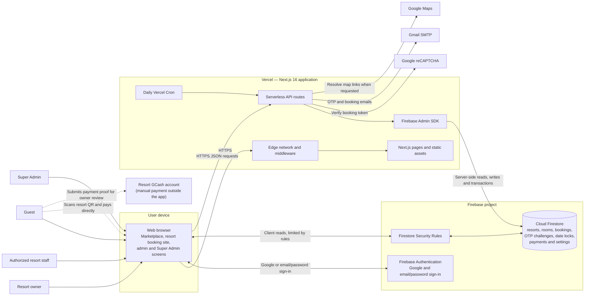

**Important boundary:** GCash payment is manual. The application displays the resort's QR code and records uploaded payment proof; it does not process a GCash transaction or use a payment gateway.

**Brief explanation — purpose, function, and flow:** Para ito ipakita ang kabuuang architecture at deployment boundaries ng system. Dinadala ng browser ang user request sa Vercel; ang Next.js pages at API routes ang nagpoproseso nito, at kumokonekta ang server sa Firebase o external services kung kailangan. Direktang hiwalay sa application ang aktuwal na GCash transfer.

### Diagram 2: Class Diagram

The class diagram models the persistent records and their relationships. OTP challenges and date locks are server-managed records; payment history is separate from the booking's current payment status.

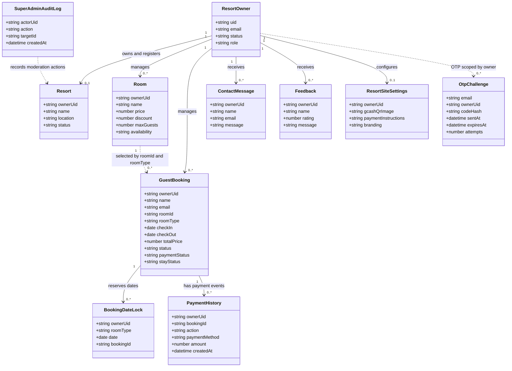

**Brief explanation — purpose, function, and flow:** Ipinapakita ng class diagram ang mga pangunahing uri ng data, mga field ng mga ito, at ugnayan ng mga record. Halimbawa, ang owner ay may resort at rooms, habang ang booking ay may date locks at payment-history events. Blueprint ito ng data structure, hindi sunod-sunod na user workflow.

### Diagram 3: Component Diagram

The component diagram groups the application into UI, API, shared server libraries, data access, and external services. It highlights the browser's limited direct Firestore access and the server-side use of the Firebase Admin SDK.

```mermaid
flowchart TB
    subgraph UI["Presentation components — Next.js pages, React components and hooks"]
        Marketplace["Resort marketplace and registration"]
        GuestSite["Guest resort site and booking form"]
        AdminUI["Owner and staff admin dashboard"]
        SuperUI["Super Admin console"]
        Hooks["Branding, auth and data hooks"]
        Marketplace --> Hooks
        GuestSite --> Hooks
        AdminUI --> Hooks
        SuperUI --> Hooks
    end

    subgraph API["Next.js API route components"]
        BookingAPI["Booking APIs<br/>availability, OTP, booking, payments"]
        AdminAPI["Admin APIs<br/>booking, staff and payment operations"]
        ResortAPI["Resort and payment settings APIs"]
        ContactAPI["Contact and feedback APIs"]
        UtilityAPI["Maps resolver, invoices and reminders"]
    end

    subgraph Shared["Shared server libraries"]
        Tenant["Tenant and authorization checks"]
        OTP["OTP challenge service"]
        Mail["Mail and notification service"]
        Invoice["Invoice and receipt builders"]
        BookingCore["Booking validation and date-lock logic"]
    end

    subgraph Data["Firebase services"]
        ClientSDK["Firebase client SDK"]
        AdminSDK["Firebase Admin SDK"]
        Auth["Firebase Authentication"]
        Rules["Firestore Security Rules"]
        Firestore[("Cloud Firestore")]
        ClientSDK --> Auth
        ClientSDK --> Rules --> Firestore
        AdminSDK --> Firestore
    end

    subgraph External["External integrations"]
        Recaptcha["Google reCAPTCHA"]
        Gmail["Gmail SMTP"]
        Maps["Google Maps"]
    end

    Marketplace --> ResortAPI
    GuestSite --> BookingAPI
    AdminUI --> AdminAPI
    SuperUI --> ResortAPI
    SuperUI --> AdminAPI
    BookingAPI --> Tenant
    BookingAPI --> OTP
    BookingAPI --> BookingCore
    BookingAPI --> Mail
    AdminAPI --> Tenant
    AdminAPI --> BookingCore
    AdminAPI --> Invoice
    AdminAPI --> Mail
    ResortAPI --> Tenant
    ContactAPI --> Mail
    UtilityAPI --> Invoice
    UtilityAPI --> Mail
    BookingAPI --> Recaptcha
    OTP --> AdminSDK
    BookingCore --> AdminSDK
    Tenant --> AdminSDK
    Mail --> Gmail
    UtilityAPI --> Maps
```

**Brief explanation — purpose, function, and flow:** Ipinapakita nito ang software modules at kung paano sila umaasa sa isa't isa. Nagsisimula ang interaction sa UI, dumadaan sa angkop na API at shared logic, at kumokonekta sa Firebase o external service. Nililinaw nito kung aling component ang may responsibilidad sa bawat gawain.

### Diagram 4: Deployment Diagram

This deployment view shows the runtime nodes and network boundaries for the production system. Vercel hosts the Next.js application; Firebase and Google services remain managed external services.

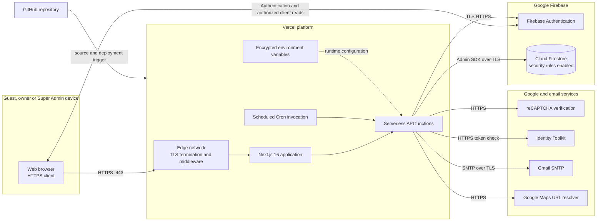

**Brief explanation — purpose, function, and flow:** Ipinapakita ng deployment diagram kung saan tumatakbo ang application sa production at saang network nodes ito kumokonekta. Ang browser ay kumokonekta sa Vercel sa HTTPS; ang Vercel functions naman ang kumokonekta sa Firebase, reCAPTCHA, email, at iba pang kinakailangang service.

### Diagram 5: Object Diagram

This object diagram is an illustrative snapshot, not live guest data. It shows a resort, owner, room, booking, and associated payment event as instances of the modeled classes.

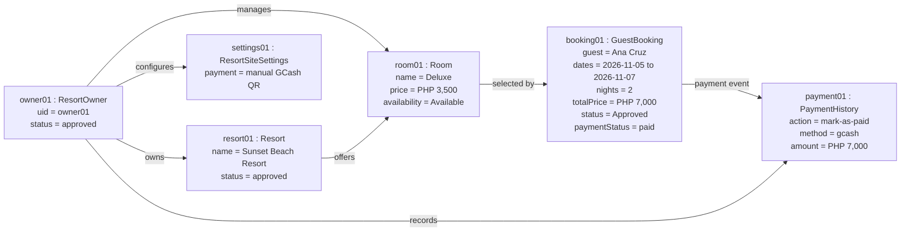

**Brief explanation — purpose, function, and flow:** Isa itong halimbawa ng aktuwal na instances batay sa mga class na ipinakita sa Diagram 2. Ipinapakita nito kung paano magkakaugnay ang isang sample owner, resort, room, booking, settings, at payment event sa isang snapshot; hindi ito live guest data o workflow.

### Diagram 6: Package Diagram

The package diagram summarizes the repository's major code packages and their dependencies.

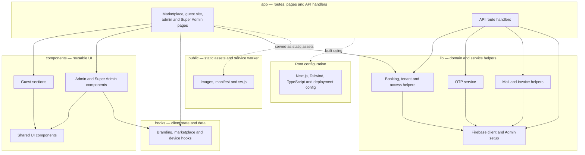

**Brief explanation — purpose, function, and flow:** Ipinapakita nito kung paano pinangkat ang source code sa repository at kung saan nanggagaling ang dependencies. Halimbawa, gumagamit ang pages at API routes ng shared helpers sa `lib/`, habang umaasa ang UI sa components at hooks. Nakakatulong ito sa pag-navigate at pag-maintain ng codebase.

### Diagram 7: Composite Structure Diagram — Booking Service

This diagram opens the booking service into collaborating parts and shows the main ports and connections used by booking requests.

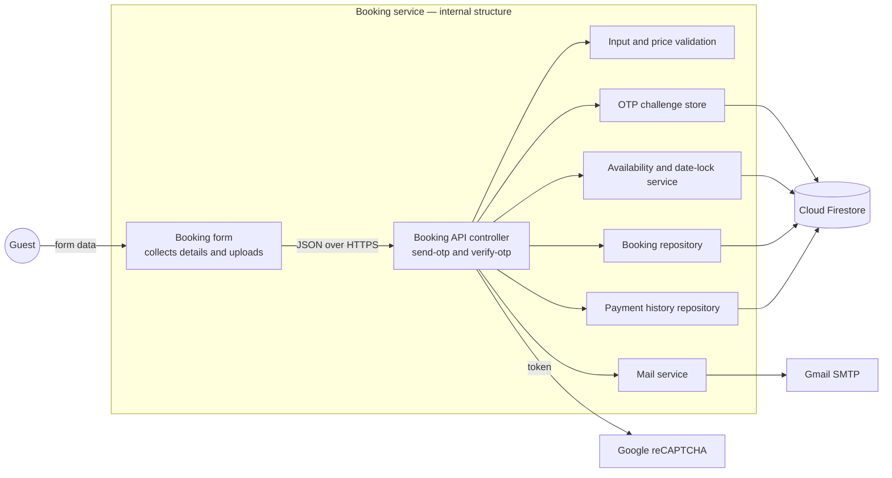

**Brief explanation — purpose, function, and flow:** Nagfo-focus ito sa internal na bahagi ng booking service at sa koneksyon ng mga ito. Mula sa guest form, pumapasok ang data sa API controller, dumadaan sa validation, CAPTCHA/OTP at availability checks, at pagkatapos ay sa Firestore repositories at mail service. Ipinapakita nito kung paano nagtutulungan ang subcomponents para sa booking request.

### Diagram 8: Profile Diagram — Project UML Profile

This project profile defines a consistent set of stereotypes for documenting the app's pages, API routes, Firestore data, roles, and integrations.

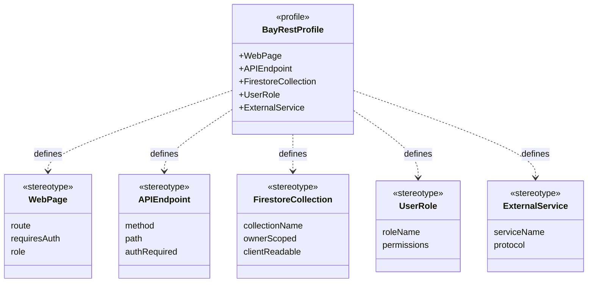

**Brief explanation — purpose, function, and flow:** Tinutukoy ng profile diagram ang mga project-specific UML stereotype na gagamitin sa pagdodokumento ng system. Nagtatakda ito ng pare-parehong labels at katangiang ilalapat sa pages, endpoints, collections, roles, at integrations; wala itong runtime data flow.

## 3. Behavioral Diagrams (9)

### Diagram 9: Data Flow Diagram (DFD), Level 1

This DFD shows the principal actors, transformations, data stores, and integrations involved in guest booking and owner review.

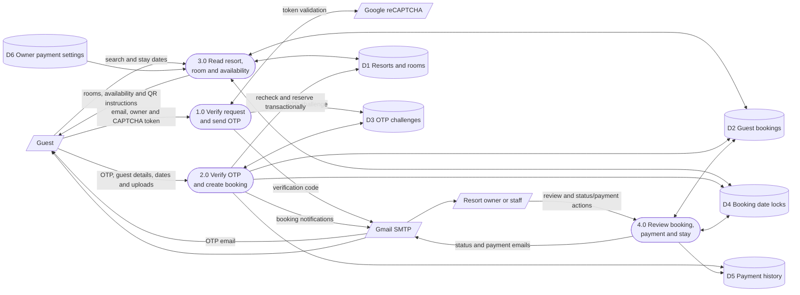

**Brief explanation — purpose, function, and flow:** Sinusubaybayan ng DFD kung saan pumapasok, napoproseso, at naiimbak ang data. Mula sa guest input, dumadaan ang request sa CAPTCHA/OTP at availability checks, saka isinusulat ang booking at date locks sa Firestore; maaari namang baguhin o suriin ng owner ang booking at payment sa admin workflow.

### Diagram 10: Use Case Diagram

This diagram defines the system scope and the responsibilities of the guest, resort owner/staff, and Super Admin. Google Authentication, reCAPTCHA, and Gmail SMTP are external services that support selected use cases.

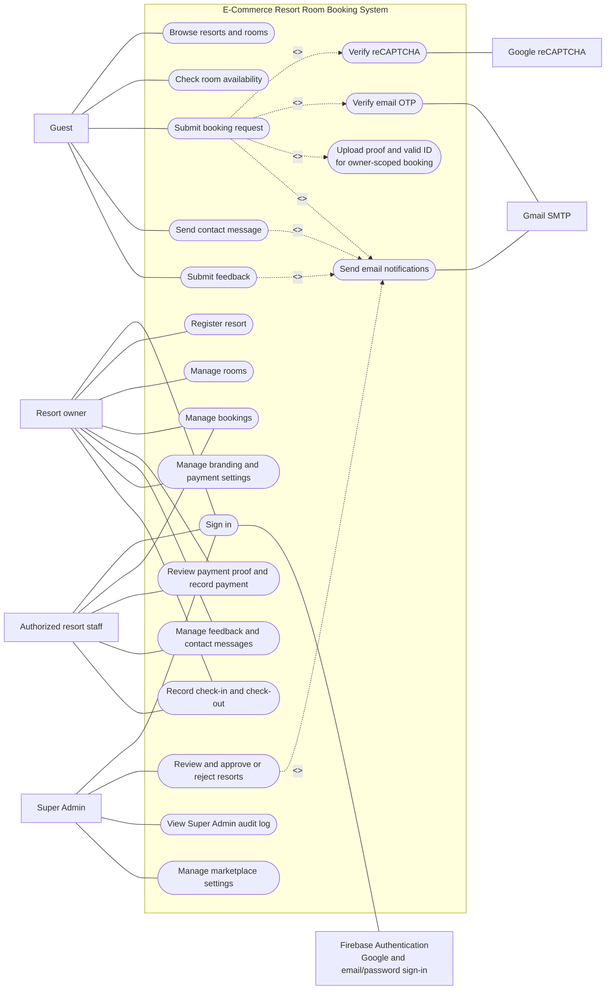

**Brief explanation — purpose, function, and flow:** Nililinaw ng use case diagram ang mga layunin at function na available sa bawat actor. Ipinapakita nito kung ano ang maaaring gawin ng guest, owner/staff, at Super Admin, pati ang mga external service na sumusuporta sa ilang gawain. Hindi ito chronological flow; scope at responsibility ang pangunahing ipinapakita.

### Diagram 11: Activity Diagram — Guest Booking Request

This activity diagram follows one guest booking from availability checking to creation of a pending booking. It includes the reCAPTCHA and email OTP checks, with the system rechecking availability transactionally before it saves the booking.

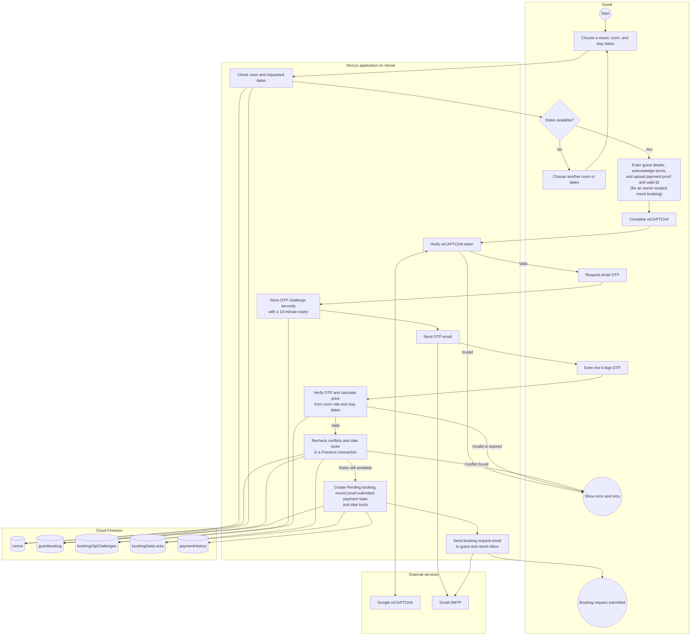

**Brief explanation — purpose, function, and flow:** Inilalarawan ng activity diagram ang sunod-sunod na hakbang at decision points sa guest booking. Mula sa pagpili ng room at dates, sinusuri ang availability, CAPTCHA, at OTP; bago gumawa ng Pending booking, muling sinusuri ng Firestore transaction ang conflicts. Kapag nabigo ang alinmang check, ipinapakita ang error sa halip na magpatuloy.

### Diagram 12: Sequence Diagram — Guest Booking Request

This sequence diagram shows the request/response order for CAPTCHA validation, OTP delivery, and the transactional booking creation. Payment proof and valid ID are uploaded with the booking details for owner-scoped resort bookings.

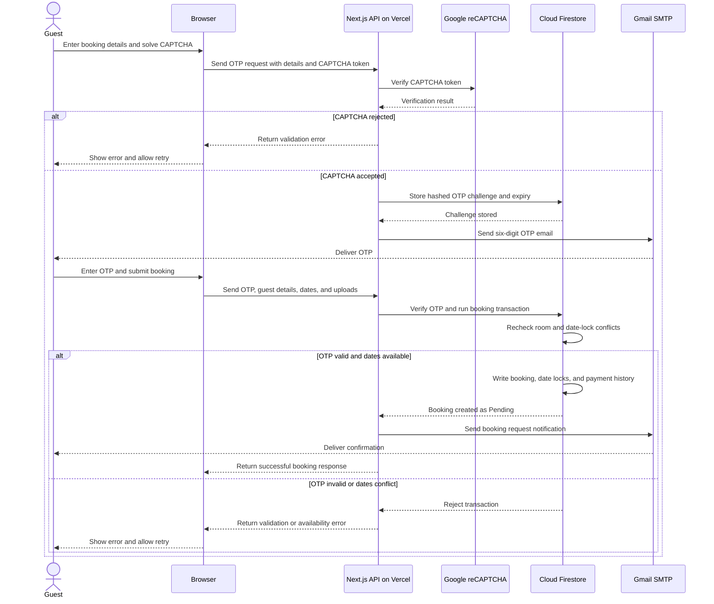

**Brief explanation — purpose, function, and flow:** Ipinapakita ng sequence diagram ang pagkakasunod-sunod ng messages sa paglipas ng panahon. Nagpapadala ang browser ng CAPTCHA token at booking data sa API; nakikipag-ugnayan ang API sa reCAPTCHA, Firestore, at Gmail; pagkatapos ay ibinabalik ang resulta ng booking o validation error sa guest.

### Diagram 13: State Machine Diagram — Booking and Payment

Booking status and payment status are separate lifecycles. This diagram shows both so an owner can review payment without implying that payment automatically changes the booking status.

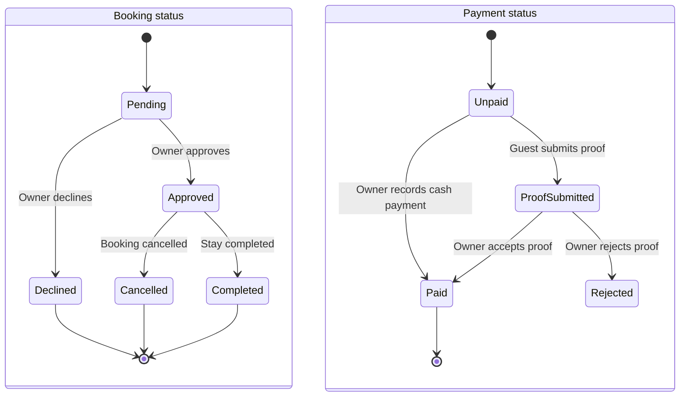

**Brief explanation — purpose, function, and flow:** Ipinapakita nito ang lifecycle at pinapahintulutang pagbabago ng booking at payment status. Halimbawa, ang Pending booking ay maaaring maging Approved o Declined; hiwalay dito, ang payment ay maaaring manatiling proof-submitted hanggang ma-review. Hindi ibig sabihin ng paid na awtomatikong approved o completed na ang booking.

### Diagram 14: Communication Diagram — Booking Collaboration

The numbered messages emphasize which participants communicate and the order of the main guest-booking interactions.

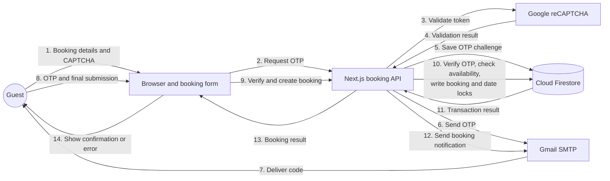

**Brief explanation — purpose, function, and flow:** Ipinapakita ng communication diagram kung aling participants ang nagpapalitan ng messages at kung anong pagkakasunod-sunod ang gamit sa numbered labels. Ang guest, browser, API, reCAPTCHA, Firestore, at Gmail ay nagtutulungan mula sa OTP request hanggang sa pagbalik ng confirmation o error.

### Diagram 15: Interaction Overview Diagram — Guest Booking

This overview organizes the booking interactions into reusable sub-flows and shows the decision points between them.

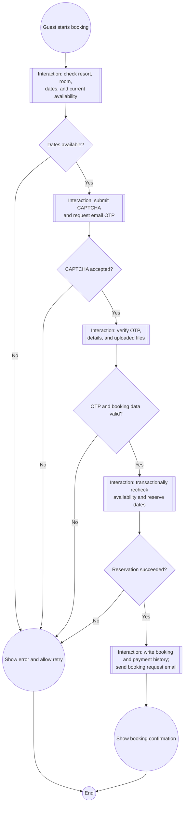

**Brief explanation — purpose, function, and flow:** Nagbibigay ito ng high-level na overview ng magkakaugnay na booking interactions at kanilang decision points. Sinisimulan ang flow sa availability check, nagpapatuloy sa CAPTCHA at OTP validation, at nagtatapos sa transactional reservation at notification o sa error path. Mas nakatuon ito sa pag-uugnay ng sub-flows kaysa sa detalye ng bawat message.

### Diagram 16: Timing Diagram — Email OTP Challenge

Mermaid does not provide a dedicated UML timing-diagram syntax, so this event timeline documents the real OTP time constraints without suggesting that event spacing is to scale. A challenge expires after 10 minutes, can be resent after 60 seconds, and permits up to five verification attempts.

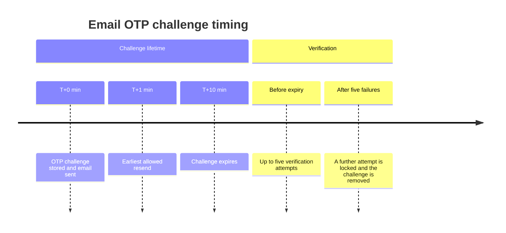

**Brief explanation — purpose, function, and flow:** Ipinapakita ng timeline ang mahahalagang oras at limitasyon ng OTP challenge. Kapag naipadala na ang code, kailangang gamitin ito bago lumipas ang 10 minuto; maaari lamang mag-resend pagkalipas ng 60 segundo at hanggang limang verification attempts ang pinapayagan. Nililinaw ng diagram ang timing, hindi ang booking workflow.

### Diagram 17: Requirement Diagram — Booking Controls

This SysML-style requirement diagram connects the booking requirements to the application components responsible for satisfying or verifying them.

```mermaid
requirementDiagram
    requirement captcha_req {
        id: BR-01
        text: Booking OTP requests must pass reCAPTCHA verification
        risk: high
        verifymethod: test
    }
    requirement otp_req {
        id: BR-02
        text: Email OTP challenges must expire after 10 minutes and allow no more than five attempts
        risk: high
        verifymethod: test
    }
    requirement availability_req {
        id: BR-03
        text: Booking creation must transactionally recheck room availability and date locks
        risk: high
        verifymethod: test
    }
    requirement payment_req {
        id: BR-04
        text: Booking status and payment status must be recorded and reviewed separately
        risk: medium
        verifymethod: inspection
    }
    element booking_api {
        type: Next.js API routes
        docref: app/api/booking
    }
    element otp_store {
        type: Firestore OTP challenge store
        docref: lib/otp-store.js
    }
    element firestore_transaction {
        type: Cloud Firestore transaction
        docref: booking creation and date-lock writes
    }
    element owner_payment_review {
        type: Owner payment review workflow
        docref: Admin payment management
    }

    booking_api - satisfies -> captcha_req
    otp_store - satisfies -> otp_req
    firestore_transaction - satisfies -> availability_req
    owner_payment_review - satisfies -> payment_req
```

**Brief explanation — purpose, function, and flow:** Iniuugnay ng requirement diagram ang mga functional requirement sa component na tumutupad o nagve-verify sa mga ito. Halimbawa, booking API ang tumutugon sa CAPTCHA requirement at Firestore transaction ang nagpapatupad ng huling availability check. Nakakatulong ito para masubaybayan ang requirement hanggang sa implementation at verification method.

## 4. Data Blueprinting

The guest's room choice, dates, contact details, OTP, and (for an owner-scoped resort) payment proof and valid ID enter through the browser. The browser sends the OTP request and booking details to Next.js API routes on Vercel; the server verifies the reCAPTCHA token with Google, sends the OTP through Gmail SMTP, and stores the OTP challenge in Firestore. After the guest returns the OTP, the server verifies it, recalculates the total using the stored room price and stay dates, and uses a Firestore transaction to recheck availability before writing the pending booking, date locks, and payment-history event. Owners review bookings and payment status through authenticated admin routes.

## 5. Notes on the Initial Draft

- This blueprint now contains all **17 diagrams** listed in the assignment: **8 structural** and **9 behavioral**.
- The current OTP challenge is stored in the server-only Firestore `bookingOtpChallenges` collection. It expires after **10 minutes**, has a **60-second resend delay**, and allows up to **5 verification attempts**; it is not an in-memory five-minute OTP.
- Booking status and payment status are separate. A booking can be `Pending` while its payment is `proof_submitted`; an owner reviews payment separately.
- GCash is a manual QR payment, not a payment gateway integrated with the system.
- The current booking API does not enforce the draft's stated limit of three bookings per email, so that rule is intentionally omitted.
